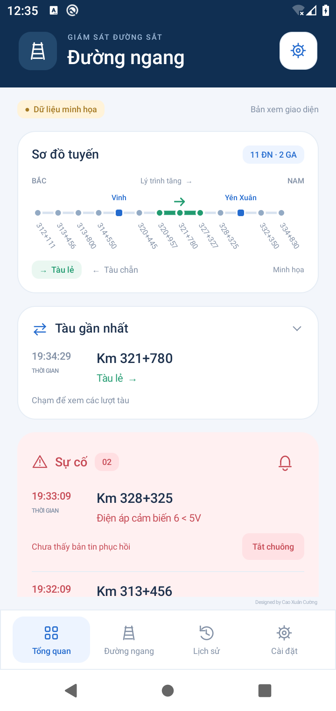
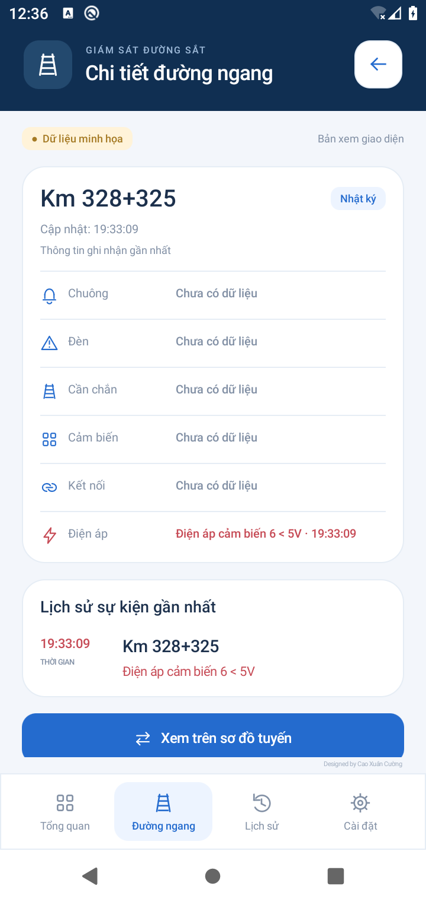

# Đường Ngang — Android 0.2

Ứng dụng Android native, tiếng Việt, xanh dương; sơ đồ tuyến cố định phía trên, khối tàu riêng, sự cố nền đỏ nhạt, lịch sử chọn ngày và ghi chú đếm trục. Dòng sự kiện: **Giờ · Đường ngang · Nội dung**. Không chứa tài khoản thử nghiệm trong mã nguồn.

## Giao diện 0.2

- Đầu trang xanh navy, thẻ trắng bo góc, biểu tượng nét đồng nhất và thanh điều hướng Tổng quan / Đường ngang / Lịch sử / Cài đặt.
- Sơ đồ tuyến thu gọn vừa chiều ngang màn hình, đủ 11 đường ngang và 2 ga; trong chế độ minh họa có đoạn xanh lá và mũi tên.
- Tàu gần nhất, sự cố và tra cứu là các khối riêng; giờ, tên đường ngang và sự kiện được căn cột. Không lặp lượt tàu đầu khi mở rộng.
- Màn hình đăng nhập riêng, chọn chu kỳ dạng nút, tùy chọn chuông và minh họa. Khi chưa có tài khoản, mặc định mở dữ liệu minh họa có nhãn rõ ràng.
- Trang chi tiết mở từ mốc tuyến hoặc danh sách: Chuông, Đèn, Cần chắn, Cảm biến, Kết nối, Điện áp; kèm thời điểm ghi nhận và lịch sử. Không có camera.
- Khởi động lại sau gián đoạn qua ngày hoặc gián đoạn trên 24 giờ: sau khi đọc ngày hiện tại thành công, đặt mốc mới, không phát lại lỗi cũ, giữ lịch sử; tick xanh mang nghĩa “Chưa ghi nhận lỗi mới”, không xác nhận thiết bị đã phục hồi.
- Không tự thêm camera, lịch tàu dự kiến hoặc trạng thái đã xử lý từ ảnh tham khảo.

## Trạng thái thực tế

Đây là bản phát triển đầu tiên, **chưa dùng làm công cụ trực vận hành**. Môi trường trả `403 Domain forbidden` khi truy cập `http://visitec.vn:7447/`; chưa xác minh đăng nhập, biểu mẫu chọn ngày, phân trang, màu lấy từ CSS ngoài hoặc ý nghĩa từng bản ghi bằng web thật. Bộ đọc ASP.NET hiện là adapter bảo thủ, dừng và báo gián đoạn nếu không nhận diện được dữ liệu. Không tuyên bố tương thích mọi website.

Đã triển khai:
- Giao diện Android, chế độ minh họa được ghi nhãn riêng, không trộn dữ liệu thật.
- Nhập URL, ID, mật khẩu; mật khẩu mã hóa AES-GCM với khóa Android Keystore; tắt sao lưu ứng dụng. HTTP của website vẫn truyền dữ liệu không mã hóa trên mạng.
- Foreground service do người dùng bật/tắt; chu kỳ 30/120/300 giây, thông báo thường trực, tùy chọn chuông hoặc im lặng. Cần kiểm tra trên điện thoại thật khi khóa màn hình, Doze và chế độ pin của nhà sản xuất; chưa bảo đảm chu kỳ tuyệt đối.
- Lịch sử SQLite theo tài khoản/URL, lọc ngày và điểm; tải ngày cũ không phát cảnh báo.
- Khung đọc đăng nhập, ngày, phân trang; chỉ lưu khi lượt đọc hoàn tất. Đọc lại toàn bộ ngày hiện tại; đặt lại mốc sau gián đoạn qua ngày khi khởi động lại hoặc trên 24 giờ. Lịch sử cũ vẫn tải riêng theo ngày.
- Ghi chú số trục theo số xuất hiện nhiều nhất trong sáu CB, có thể đồng thời thừa/thiếu; hòa chuẩn ghi đúng “cảm biến đếm trục không đồng nhất, lỗi”. Có V hoặc thiếu ô thì không suy diễn.
- Khôi phục thiết bị chỉ xóa lỗi tương ứng, “Khôi phục hệ thống” không xóa toàn bộ lỗi.
- Quy tắc xác định upstream/tự kích có kiểm thử; **chưa bật phát cảnh báo tự kích trên service** vì thiếu dữ liệu thực tế và ngưỡng thời gian đối chiếu đã xác nhận.

Còn phải hoàn thiện trước khi bàn giao:
- Xác minh adapter với HTML thật; nhận diện ID sự kiện để phân biệt bản ghi trùng nội dung/cùng giây, đọc chồng và kiểm tra trang đầu lần nữa khi dữ liệu dịch trang; hiện chưa bảo đảm không bỏ sót khi web đang đổi trang.
- Đọc ngày trước khi khởi động để nối chu trình qua nửa đêm và dựng lỗi tồn tại từ trước hôm nay. Hiện khối sự cố chỉ dựa trên dữ liệu hôm nay đã tải.
- Ghép nhiều lượt tàu, ngưỡng thời gian từng đoạn; thử dữ liệu tự kích và dữ liệu mất kết nối, rồi nối quy tắc vào cảnh báo.
- **Sơ đồ hiện chỉ tô đoạn tàu trong chế độ minh họa**. Chưa vẽ tàu thật; cần bộ ghép lượt tàu và mốc vào/ra ga đáng tin cậy. Không hiển thị vị trí giả từ GPS.
- Lấy danh sách điểm từ tài khoản thật; danh sách lọc/sơ đồ hiện là cấu hình 13 điểm của khu vực Vinh, không được coi đã hỗ trợ tự động mọi khu vực.
- Kiểm tra UI/chuông/permission và foreground service trên thiết bị Android; kiểm tra đọc toàn bộ lịch sử, không báo lại sự kiện đã khôi phục, phân loại khôi phục cần chắn không có số thứ tự.

## Build

JDK 21, Gradle 8.9, Android SDK platform 35, build-tools 35.0.0; Android tối thiểu 8.0 (API 26). `scripts/env.sh` kích hoạt toolchain đã cài trong môi trường cloud; ngoài cloud dùng Android Studio hoặc thiết lập đường dẫn tương ứng.

```sh
source scripts/env.sh
./scripts/test-rules.sh
gradle --no-daemon --max-workers=2 assembleDebug lintDebug
```

APK phát triển: `app/build/outputs/apk/debug/app-debug.apk`. Debug APK dùng để thử, bản phát hành cần khóa ký riêng để giữ được khả năng cập nhật.

## Thử trên điện thoại

Cài APK, mở Cài đặt → bật dữ liệu minh họa để xem bố cục. Muốn thử kết nối thật, nhập URL/ID/mật khẩu trên điện thoại, cấp quyền thông báo rồi Lưu & theo dõi. Dừng theo dõi bằng nút trong Cài đặt. Chưa có tự chạy lại sau khởi động máy; người dùng chủ động bật dịch vụ.

Tuyến từ Bắc xuống Nam gồm 11 đường ngang và 2 điểm ga. Hai nhóm đối chiếu:
- 312+111 → 313+456 → 313+800 → 314+550.
- 320+445 → 320+957 → 321+780 → 327+327 → 328+325 → 332+350 → 334+830.

Ga Vinh giữa 314+550 và 320+445; ga Yên Xuân giữa 328+325 và 332+350. Hai điểm ga không làm chứng cứ suy luận tự kích. Tàu lẻ đi tăng lý trình, tàu chẵn đi giảm lý trình. CB3/4 giải phóng đường ngang để nâng chắn; qua cặp cảm biến phía xa bên kia rồi một phút mới khôi phục toàn chu trình.

## Ảnh chụp bản 0.2 trên Android giả lập




