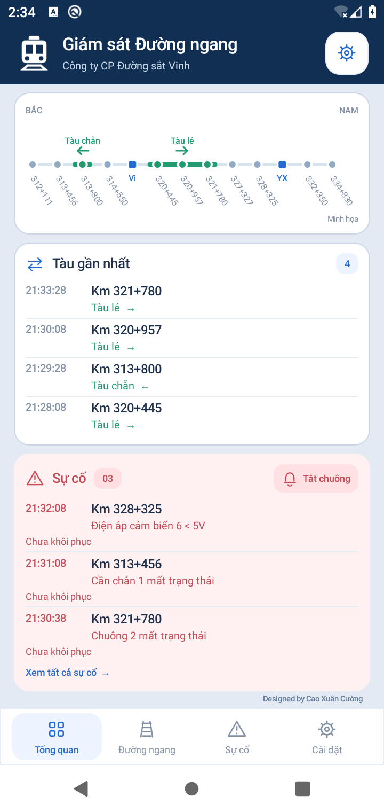

# Đường Ngang — Android 0.5

Ứng dụng Android native, tiếng Việt, xanh dương; sơ đồ tuyến cố định phía trên, khối tàu riêng, sự cố nền đỏ nhạt, lịch sử chọn ngày và ghi chú đếm trục. Dòng sự kiện: **Giờ · Đường ngang · Nội dung**. Không chứa tài khoản thử nghiệm trong mã nguồn.

## Bản 0.5: tuyến theo tài khoản, lỗi đúng thiết bị, sơ đồ chiếm dụng

- Sau lượt đọc web hoàn tất, lấy toàn bộ danh sách điểm từ bộ chọn lý trình (hoặc bảng Km / Status), sắp xếp theo giá trị km từ Bắc vào Nam. Không dựng danh sách tuyến từ các dòng sự kiện vì có điểm chưa phát sinh bản tin.
- Hậu tố trong ngoặc là ga, dùng nguyên chữ bên trong làm nhãn, ví dụ Vi, YX, CS, MLy, QHa. Mọi ga ngắt đối chiếu đường ngang liền kề ở cả hai phía. Ga và đầu/cuối tuyến không cần chứng cứ từ phía không có đường ngang liền kề.
- Danh sách chọn phạm vi, danh sách đường ngang và lọc chuông dùng tuyến của tài khoản hiện tại. Đổi URL hoặc ID thì xóa dữ liệu/mốc/phạm vi tuyến cũ; kết quả tải muộn của tài khoản cũ bị từ chối. Phạm vi minh họa và phạm vi thực tách riêng.
- Sơ đồ vẫn giữ toàn bộ tuyến khi thu hẹp phạm vi. Tuyến nhiều điểm có khung cuộn ngang để giữ khoảng cách mốc; trang Tổng quan vẫn không cuộn dọc.
- Giữ nguyên nội dung bản tin lỗi, gồm số chuông/đèn/cần chắn. Chuông và đèn được ghép khôi phục theo số thiết bị; không gộp chuông 1 với chuông 2. Chạm lỗi ở Tổng quan để đọc trọn câu; màn hình chi tiết ưu tiên hiển thị các lỗi còn tồn tại trong nhóm thiết bị.
- Sơ đồ dựng trạng thái từng đường ngang từ bản tin: “Tàu lẻ/chẵn” bật xanh, “Khôi phục hệ thống” của đúng điểm bỏ xanh. Tàu qua CB3/4 và cần chắn nâng không giải phóng toàn khu vực. Không tự dịch chuyển mũi tên theo đồng hồ, không xóa điểm trước khi điểm sau báo tàu. Hiển thị đồng thời nhiều đoạn và hướng; một đoàn tàu có thể chiếm dụng nhiều đường ngang nên không lấy số điểm xanh làm số tàu.
- Khi có dữ liệu lưu từ lượt đọc thành công, sơ đồ dùng cả hôm nay và dữ liệu hôm qua đã lưu để nối qua ngày. Nếu chưa có bản tin thì không suy diễn trạng thái. Đang gián đoạn hoặc dữ liệu quá hai chu kỳ (ít nhất 60 giây): đổi màu đoạn giữ lại sang vàng nâu và ghi “Dữ liệu cũ” cùng giờ cập nhật cuối. Chu kỳ đọc không phải GPS liên tục.
- **Chưa xác minh sơ đồ bằng Visitec thật.** Kiểm tra bằng dữ liệu mô phỏng và dữ liệu lưu trong giả lập. Chưa bảo đảm trạng thái qua nửa đêm khi khởi động mới mà chưa tải ngày trước; bản này không gán danh tính hay suy ra số đoàn tàu từ các điểm xanh.

## Giao diện 0.4 (trước đây)

- Đầu trang “Giám sát Đường ngang” / “Công ty CP Đường sắt Vinh”; biểu tượng đầu tàu trắng trên nền navy dùng thống nhất trong app và ngoài màn hình điện thoại.
- Sơ đồ luôn giữ đủ 11 đường ngang và 2 ga, kể cả khi chọn phạm vi theo dõi hẹp. Bỏ “Lý trình tăng” và chú giải cố định; hướng “Tàu lẻ” / “Tàu chẵn” nằm ngay trên mũi tên. Đoạn tàu hiện vẫn là minh họa có nhãn.
- Trang Tổng quan tự chia chiều cao giữa hai khối tàu và sự cố để vừa màn hình, không cuộn dọc. Số dòng và khoảng cách thích ứng theo chiều cao, cỡ chữ và lượng dữ liệu; xem phần còn lại tại danh sách đầy đủ. Không cố định ba dòng mỗi khối.
- Chỉ một nút “Tắt chuông” cạnh biểu tượng chuông ở đầu khối Sự cố; không lặp nút sau từng lỗi. Tắt chuông giữ nguyên trạng thái lỗi.
- Nền ngoài tương phản hơn với các thẻ; dòng “Designed by Cao Xuân Cường” lớn và đậm hơn.
- Phạm vi chỉ lọc danh sách, sự cố và chuông; dữ liệu tuyến vẫn giữ đầy đủ để theo dõi ngữ cảnh.

## Giao diện 0.3 (trước đây)

- Bỏ dải trạng thái phụ và dòng tiêu đề/đếm điểm trên sơ đồ; nhãn minh họa thu nhỏ vào đầu trang để không nhầm với dữ liệu thật.
- Giảm cỡ chữ, đệm thẻ, khoảng cách và chiều cao thanh điều hướng. Trang chính hiện sẵn tối đa 3 lượt tàu gần nhất và 3 sự cố; có thể mở rộng lượt tàu hoặc vào danh sách sự cố.
- Đổi câu trạng thái thành “Chưa khôi phục”. Không còn khối tra cứu lịch sử trên trang chính; thanh dưới dùng Tổng quan / Đường ngang / Sự cố / Cài đặt.
- Mục Sự cố có bộ lọc Tất cả / Chưa khôi phục / Đã khôi phục, chọn ngày để xem lại. Chỉ tick xanh “Đã khôi phục” nếu có bản tin phục hồi tương ứng; đặt lại mốc do thiếu dữ liệu không tính là khôi phục.
- Chọn phạm vi từ đường ngang đến đường ngang (bao gồm hai đầu), áp dụng độc lập với đăng nhập; lưu qua các lần mở app. Sơ đồ, lượt tàu, sự cố và chuông báo chỉ áp dụng trong phạm vi đã chọn; hỗ trợ một điểm riêng lẻ.
- Giữ trang chi tiết 6 nhóm thiết bị và lịch sử riêng của đường ngang.

## Giao diện 0.2

- Đầu trang xanh navy, thẻ trắng bo góc, biểu tượng nét đồng nhất và thanh điều hướng Tổng quan / Đường ngang / Lịch sử / Cài đặt.
- Sơ đồ tuyến thu gọn vừa chiều ngang màn hình, đủ 11 đường ngang và 2 ga; trong chế độ minh họa có đoạn xanh lá và mũi tên.
- Tàu gần nhất, sự cố và tra cứu là các khối riêng; giờ, tên đường ngang và sự kiện được căn cột. Không lặp lượt tàu đầu khi mở rộng.
- Màn hình đăng nhập riêng, chọn chu kỳ dạng nút, tùy chọn chuông và minh họa. Khi chưa có tài khoản, mặc định mở dữ liệu minh họa có nhãn rõ ràng.
- Trang chi tiết mở từ mốc tuyến hoặc danh sách: Chuông, Đèn, Cần chắn, Cảm biến, Kết nối, Điện áp; kèm thời điểm ghi nhận và lịch sử. Không có camera.
- Khởi động lại sau gián đoạn qua ngày hoặc gián đoạn trên 24 giờ: sau khi đọc ngày hiện tại thành công, đặt mốc mới, không phát lại lỗi cũ, giữ lịch sử; tick xanh mang nghĩa “Chưa ghi nhận lỗi mới”, không xác nhận thiết bị đã phục hồi.
- Không tự thêm camera, lịch tàu dự kiến hoặc trạng thái đã xử lý từ ảnh tham khảo.

## Trạng thái thực tế

Đây là bản phát triển đầu tiên, **chưa dùng làm công cụ trực vận hành**. Môi trường trả `403 Domain forbidden` khi truy cập `http://visitec.vn:7447/`; chưa xác minh đăng nhập, biểu mẫu chọn ngày, phân trang, màu lấy từ CSS ngoài hoặc ý nghĩa từng bản ghi bằng web thật. Bộ đọc ASP.NET hiện là adapter bảo thủ, dừng và báo gián đoạn nếu không nhận diện được dữ liệu. Không tuyên bố tương thích mọi website.

Đã triển khai:
- Giao diện Android, chế độ minh họa được ghi nhãn riêng, không trộn dữ liệu thật.
- Nhập URL, ID, mật khẩu; mật khẩu mã hóa AES-GCM với khóa Android Keystore; tắt sao lưu ứng dụng. HTTP của website vẫn truyền dữ liệu không mã hóa trên mạng.
- Foreground service do người dùng bật/tắt; chu kỳ 30/120/300 giây, thông báo thường trực, tùy chọn chuông hoặc im lặng. Cần kiểm tra trên điện thoại thật khi khóa màn hình, Doze và chế độ pin của nhà sản xuất; chưa bảo đảm chu kỳ tuyệt đối.
- Lịch sử SQLite theo tài khoản/URL, lọc ngày và điểm; tải ngày cũ không phát cảnh báo.
- Khung đọc đăng nhập, ngày, phân trang; chỉ lưu khi lượt đọc hoàn tất. Đọc lại toàn bộ ngày hiện tại; đặt lại mốc sau gián đoạn qua ngày khi khởi động lại hoặc trên 24 giờ. Lịch sử cũ vẫn tải riêng theo ngày.
- Ghi chú số trục theo số xuất hiện nhiều nhất trong sáu CB, có thể đồng thời thừa/thiếu; hòa chuẩn ghi đúng “cảm biến đếm trục không đồng nhất, lỗi”. Có V hoặc thiếu ô thì không suy diễn.
- Khôi phục thiết bị chỉ xóa lỗi tương ứng, “Khôi phục hệ thống” không xóa toàn bộ lỗi.
- Quy tắc xác định upstream/tự kích có kiểm thử; **chưa bật phát cảnh báo tự kích trên service** vì thiếu dữ liệu thực tế và ngưỡng thời gian đối chiếu đã xác nhận.

Còn phải hoàn thiện trước khi bàn giao:
- Xác minh adapter với HTML thật; nhận diện ID sự kiện để phân biệt bản ghi trùng nội dung/cùng giây, đọc chồng và kiểm tra trang đầu lần nữa khi dữ liệu dịch trang; hiện chưa bảo đảm không bỏ sót khi web đang đổi trang.
- Đọc ngày trước khi khởi động để nối chu trình qua nửa đêm và dựng lỗi tồn tại từ trước hôm nay. Hiện khối sự cố chỉ dựa trên dữ liệu hôm nay đã tải.
- Ghép nhiều lượt tàu, ngưỡng thời gian từng đoạn; thử dữ liệu tự kích và dữ liệu mất kết nối, rồi nối quy tắc vào cảnh báo.
- Xác minh sơ đồ chiếm dụng bằng dữ liệu thật, trạng thái vào/ra ga và nửa đêm. Sơ đồ hiện dựng theo các bản tin đã lưu, không phải vị trí GPS hoặc danh tính đoàn tàu. Kiểm chứng điều kiện khôi phục đúng theo mẫu web thực tế.
- Kiểm chứng nhận diện danh sách tuyến theo tài khoản bằng web thật; hiện đã kiểm tra với HTML và luồng đăng nhập/phân trang mô phỏng. Chưa tuyên bố tương thích mọi cấu trúc web hoặc mọi khu vực.
- Kiểm tra UI/chuông/permission và foreground service trên thiết bị Android; kiểm tra đọc toàn bộ lịch sử, không báo lại sự kiện đã khôi phục, phân loại khôi phục cần chắn không có số thứ tự.

## Build

JDK 21, Gradle 8.9, Android SDK platform 35, build-tools 35.0.0; Android tối thiểu 8.0 (API 26). `scripts/env.sh` kích hoạt toolchain đã cài trong môi trường cloud; ngoài cloud dùng Android Studio hoặc thiết lập đường dẫn tương ứng.

```sh
source scripts/env.sh
./scripts/test-rules.sh
./scripts/test-parser.sh
./scripts/build-cloud.sh assembleDebug assembleDebugAndroidTest lintDebug
# Khi có giả lập hoặc thiết bị thử:
./scripts/test-android-route.sh
```

APK phát triển: `app/build/outputs/apk/debug/app-debug.apk`. Debug APK dùng để thử, bản phát hành cần khóa ký riêng để giữ được khả năng cập nhật.

## Thử trên điện thoại

Cài APK, mở Cài đặt → bật dữ liệu minh họa để xem bố cục. Muốn thử kết nối thật, nhập URL/ID/mật khẩu trên điện thoại, cấp quyền thông báo rồi Lưu & theo dõi. Dừng theo dõi bằng nút trong Cài đặt. Chưa có tự chạy lại sau khởi động máy; người dùng chủ động bật dịch vụ.

Tuyến minh họa từ Bắc xuống Nam gồm 11 đường ngang và 2 điểm ga. Tuyến thực dùng danh sách điểm đọc từ tài khoản. Mỗi ga (hậu tố trong ngoặc) ngắt đối chiếu hai phía; ga không làm chứng cứ suy luận tự kích. Tàu lẻ đi tăng lý trình, tàu chẵn đi giảm lý trình. CB3/4 giải phóng đường ngang để nâng chắn; qua cặp cảm biến phía xa bên kia rồi một phút mới khôi phục toàn chu trình.

## Kiểm tra bản 0.5

[Chi tiết kiểm tra](docs/ROUTE_REVIEW_0.5.md). Build APK và Lint thành công; kiểm thử quy tắc, parser, web mô phỏng và lưu trữ khi đổi tài khoản. Không coi web mô phỏng là kiểm chứng Visitec thật.



[Tuyến khác có CS / MLy / QHa](docs/screenshots/account-route-0.5.png) · [Chọn phạm vi tài khoản khác](docs/screenshots/account-range-0.5.png)
