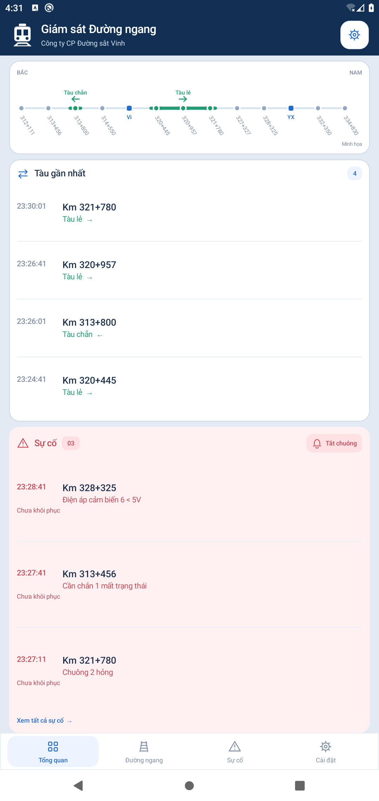

# Đường Ngang — Android 0.6

Ứng dụng theo dõi đường ngang CBTĐ, giao diện tiếng Việt xanh dương. [Tải APK](downloads/README.md). Không nhúng tài khoản hay mật khẩu thử nghiệm vào mã nguồn hoặc APK.

## Theo dõi

- Nhập website, ID, mật khẩu trong Cài đặt. Tuyến được lấy từ danh sách điểm của tài khoản, sắp xếp km từ Bắc xuống Nam. Điểm có ngoặc là ga, nhãn dùng đúng chữ trong ngoặc; ga ngắt đối chiếu đường ngang liền kề ở hai phía.
- Chọn theo dõi từ đường ngang đến đường ngang. Phạm vi lọc danh sách, sự cố và thông báo; sơ đồ vẫn giữ đủ tuyến. Đổi URL/ID xóa trạng thái của tài khoản cũ.
- Sơ đồ hiển thị những điểm được web báo có tàu, nhiều đoạn và hai hướng đồng thời. Tàu lẻ đi tăng km, tàu chẵn đi giảm km. Cần chắn nâng không xóa chiếm dụng; bản tin “Khôi phục hệ thống” đúng điểm mới xóa. Không nội suy GPS, danh tính hoặc số đoàn tàu từ số điểm xanh.
- Mọi lỗi đỏ giữ nguyên chữ trên web, gồm tên/số thiết bị. Khôi phục chỉ xóa lỗi tương ứng; khôi phục hệ thống không xóa lỗi phần cứng. Sáu nhóm chi tiết: Chuông, Đèn, Cần chắn, Cảm biến, Kết nối, Điện áp.
- Lưu lỗi chưa khôi phục và chiếm dụng qua các lần cập nhật/ngày. Sau gián đoạn qua ngày hoặc trên 24 giờ, mốc theo dõi lỗi có thể được đặt lại với “Chưa ghi nhận lỗi mới”; đây không phải bản tin thiết bị phục hồi.
- Suy luận “Nghi tự kích” từ lượt tàu mới thiếu lượt tương ứng ở đường ngang phía trước theo hướng chạy, có chờ ít nhất một chu kỳ (tối thiểu 30 giây). Không áp dụng qua ga hay đầu/cuối tuyến. Bản tin phía trước tới muộn sẽ bỏ suy luận; bản tin gốc được giữ. Đây là suy luận theo dữ liệu web, cần đối chiếu hiện trường.
- CB1–CB6 ở bản tin khôi phục hệ thống được đối chiếu số trục theo số xuất hiện nhiều nhất. Ghi chú thừa/thiếu riêng từng CB; hòa chuẩn ghi “cảm biến đếm trục không đồng nhất, lỗi”. Không phát chuông từ ghi chú, không coi bản tin đo điện áp là số trục.

## Giao diện và thông báo

Tổng quan gồm sơ đồ, tàu gần nhất và sự cố, tự chia chiều cao để vừa màn hình. Chạm để xem danh sách/chi tiết đầy đủ. Thanh dưới: Tổng quan / Đường ngang / Sự cố / Cài đặt. Mục Sự cố chọn ngày, lọc chưa/đã khôi phục, tick xanh khi có bản tin khôi phục tương ứng. Chỉ một nút tắt chuông chung; tắt chuông vẫn giữ lỗi đỏ. **“Designed by Cao Xuân Cường” chỉ hiển thị trong Cài đặt.**

Foreground service đọc theo chu kỳ 30 giây / 2 phút / 5 phút, có thông báo thường trực. Khi mới kết nối, tải ngày trước và ngày hiện tại, đọc hết phân trang rồi kiểm tra lại đầu trang; sau đó đọc chồng tới bản tin đã biết và làm mới toàn bộ định kỳ. Phiên hết hạn được đăng nhập lại; sai tài khoản/mật khẩu dừng dịch vụ để tránh thử liên tục. Tải lịch sử riêng không phát cảnh báo.

Khi dữ liệu gián đoạn/cũ, sơ đồ giữ trạng thái cuối và đổi màu cảnh báo kèm thời điểm cập nhật. Chu kỳ đọc web không phải dữ liệu liên tục tại hiện trường. Các bản ghi hoàn toàn giống nhau cùng giây được gộp do web không cung cấp ID sự kiện độc lập.

## Kiểm chứng và giới hạn

Đã đăng nhập Visitec thật, đọc đủ ngày hiện tại/ngày trước và kiểm tra lượt đọc tăng thêm. App Android trên giả lập đã đồng bộ dữ liệu thật và có 5 lượt cập nhật khi tắt màn hình trong 80 giây. Kiểm tra quy tắc, phân trang, lưu trữ và thông báo dùng thêm dữ liệu mô phỏng; xem [biên bản 0.6](docs/LIVE_REVIEW_0.6.md).

Cần thử khóa màn hình lâu, chế độ pin HyperOS và độ trễ thông báo trên Xiaomi 14T Pro trước khi dùng trực. Cài đặt có lối mở thông tin ứng dụng để chỉnh pin/thông báo. Chưa tự bật sau khởi động máy. Không bảo đảm chu kỳ tuyệt đối khi Android hạn chế chạy nền, không bảo đảm mọi website có cấu trúc khác đều tương thích. App chỉ giám sát, không điều khiển thiết bị hay thay thế quy trình trực.

Mật khẩu mã hóa bằng Android Keystore, tắt sao lưu ứng dụng; website HTTP vẫn truyền dữ liệu không mã hóa trên mạng. APK dùng chữ ký phát triển để thử và cập nhật cùng các bản trước.

## Build

JDK 21, Gradle 8.9, Android SDK 35; Android tối thiểu 8.0 (API 26).

```sh
source scripts/env.sh
./scripts/test-rules.sh
./scripts/test-parser.sh
./scripts/build-cloud.sh --offline assembleDebug assembleDebugAndroidTest lintDebug
# Với giả lập riêng đang chạy:
./scripts/test-android-route.sh
python3 scripts/test-monitoring-e2e.py
```

APK: `app/build/outputs/apk/debug/app-debug.apk`. Script kiểm tra service chỉ chấp nhận giả lập, sao lưu/khôi phục dữ liệu ứng dụng và proxy.



[Ảnh Cài đặt — dòng tên thiết kế](docs/screenshots/settings-0.6.png).
