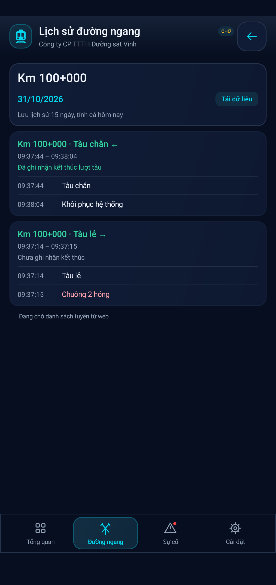

# Lịch sử 15 ngày và chi tiết từng lượt — 0.21

Ngày 31/10/2026, giờ Việt Nam. APK 0.21.0, versionCode 21, giữ applicationId/chứng chỉ cũ.

## Yêu cầu đã chốt

Chủ dự án chọn lưu 15 ngày; thay nút Xem trên sơ đồ tuyến trong màn hình đường ngang bằng Chi tiết, mở toàn bộ sự kiện của đường ngang trong ngày. Mỗi lượt tàu nằm trong một khung có viền nhẹ và tên đường ngang. Lượt mới mở khung mới dù lượt trước thiếu kết thúc, không gom kéo dài qua các đoàn; việc tách khung không xóa lỗi thiết bị thật. Bỏ nút Thử chuông báo lỗi trong Cài đặt, giữ chuông sự cố và bật/tắt âm chung. Trong lúc thực hiện, chủ dự án xác nhận chỉ gom các bản tin rời gần nhau, không gom các lượt tàu có bản tin tiếp cận riêng.

## Thực hiện

- Giữ hôm nay và 14 ngày Việt Nam trước đó. Cleanup chạy nền khi mở app, qua ngày khi app đang mở và trước lượt đọc của service, kể cả khi website không truy cập được. Không cần app chạy khi đã bị tắt hoàn toàn; lần mở/chạy tiếp theo sẽ dọn. Trang chọn ngày và tải lịch sử giới hạn trong 15 ngày gần nhất.
- Cập nhật checkpoint sơ đồ trước khi xóa bản tin cũ, ghi đồng bộ xuống đĩa trước thao tác xóa. Giữ trạng thái tàu/chiếm dụng cần thiết riêng để tàu đang giữa hai điểm không tự mất chỉ vì dữ liệu nguồn hơn 15 ngày. Lưu mốc chặn nhập lại bản tin hết hạn, tránh tải bù làm kho dữ liệu tăng trở lại; tài khoản mới xóa mốc của tài khoản trước. Dùng VACUUM sau khi có dữ liệu bị xóa để thu hồi dung lượng tệp cơ sở dữ liệu. Giữ trục, lỗi gốc trong ngày và cấu hình.
- Trang Lịch sử đường ngang có chọn ngày và Tải dữ liệu, chỉ đọc các bản tin của đường ngang đang chọn, không giới hạn 12 dòng như bản xem gần nhất. Khung mới nhất ở trên; bên trong theo trình tự thời gian tăng. Hiện nguyên văn, lỗi đỏ và ghi chú trục; ngoại lệ trục vẫn giữ. Dữ liệu tiếp tục tải từ website khi người dùng yêu cầu, không tạo dữ liệu giả.
- Bản tin tiếp cận mới luôn mở khung mới, kể cả cùng hướng và lượt cũ thiếu khôi phục. Lượt thiếu kết thúc ghi Chưa ghi nhận kết thúc. Bản tin đã qua không có tiếp cận vẫn có thể được trình bày thành lượt thiếu thông tin. Các bản tin khôi phục lặp gần nhau ở cùng lượt được giữ chung; bản tin đến xa hơn không kéo dài khung cũ.
- Bản tin rời không rõ lượt được gom theo cụm: khoảng cách liên tiếp tối đa 5 phút, tổng độ dài cụm tối đa 15 phút; không nối liên tục cả buổi. Ghi Sự kiện ngoài lượt tàu, không tự kết luận đó là tàu thật/thử thiết bị. Việc gom khung là logic hiển thị, không thay logic lỗi hay sơ đồ.
- Cập nhật lịch sử trong cửa sổ hiện có, giữ vị trí cuộn. Nút Chi tiết thay nút sơ đồ cũ; tab Đường ngang vẫn được đánh dấu khi xem lịch sử. Bỏ bộ phát thử của Activity, giữ bộ phát sáu hồi của service và nút bật/tắt chung. Chữ ký vẫn chỉ ở Cài đặt.

## Kiểm chứng

- **579 kiểm tra quy tắc** đạt: mốc ngày Việt Nam, hai hướng, lượt mới khi lượt trước thiếu kết thúc, khôi phục lặp gần/xa, gom bản tin rời có giới hạn, đảo thứ tự/đọc trùng và lọc đúng đường ngang. Các quy tắc sơ đồ/tự kích/trục trước đó vẫn đạt.
- **168 kiểm tra lưu trữ** đạt trên APK phát hành: xóa đúng phần trước mốc 15 ngày, giữ bản tin tại biên, tệp DB thu nhỏ, không nhập lại bản tin cũ, đổi tài khoản bỏ mốc cũ; checkpoint giữ tàu có nguồn quá hạn qua mở lại và chuyển tiếp được khi có bản tin mới. Đã chạy lại bộ này sau bổ sung ghi checkpoint đồng bộ.
- **69 kiểm tra giao diện cập nhật** đạt trên bản giao diện hiện tại trước bổ sung ghi checkpoint đồng bộ trong Store (không thay UI): nút Chi tiết mở trang đúng, các khung mới/cũ tách biệt, lọc đúng đường ngang, giữ cửa sổ khi cập nhật và bỏ nút thử chuông. Đã xem ảnh tổng hợp bên dưới.
- **21 kiểm tra telemetry UI** đạt trên APK phát hành, gồm nút thử chuông đã bỏ, bật/tắt chuông thật vẫn có, nhãn LIVE và tàu xanh khi dữ liệu cũ.
- **Một phiên smoke service** với máy chủ giả lập và cấu hình chu kỳ 30 giây đạt trên APK phát hành: đọc dữ liệu đầu vào, giữ im lặng khi không có lỗi đủ điều kiện, ghi đúng retentionCutoff/retentionPreparedAt theo ngày Việt Nam. Chỉ kiểm tra lượt đồng bộ đầu, không chạy lại toàn bộ 25/29 ca service hoặc khẳng định chạy qua nhiều chu kỳ trong lượt này.
- Build APK/gói kiểm thử và Lint đạt **0 lỗi, 15 cảnh báo**. Chứng chỉ SHA-256 giữ `281d109c85d7c1d4cb6dc88ed1e69972f1a44cbc74f368991c7d93fae7c18e44`.

Phân nhóm chỉ dựa trên bản tin, không nhận diện số hiệu đoàn tàu; dữ liệu thiếu hoặc sai thời gian vẫn có thể làm một phần lịch sử không xác định được lượt. Dữ liệu hết hạn được xóa trên điện thoại, không xóa website. Khi đã dọn, nguồn cũ không còn để dựng lại toàn bộ từ raw; các lần nâng cấp sau phải bảo toàn checkpoint hợp lệ. APK `downloads/DuongNgang-0.21.apk`, checksum trong downloads/SHA256SUMS. Bản ZIP sao lưu v0.14 vẫn là lịch sử. Không truy cập website công ty hoặc kiểm chứng Xiaomi thật trong lượt này. Dữ liệu kiểm tra là tổng hợp; ảnh xem trước không chứa dữ liệu vận hành hay tài khoản thực. Khóa ký riêng nằm ngoài Git, không thay đổi.
