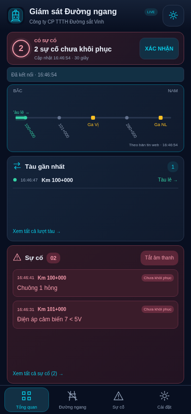
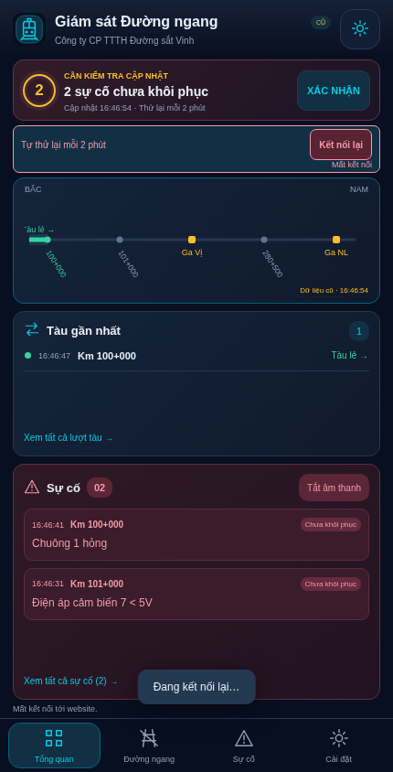
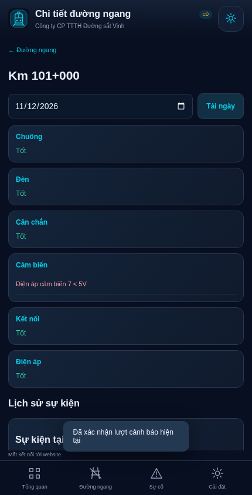

# Kết quả kiểm thử — 12/11/2026

Bản web độc lập 1.0.0, quy tắc gốc từ Android commit `ee1affe5ea024590ce356e0f1e23aafbf17df669`. Không chỉnh mã Android, APK, tài liệu hay script phát hành Android. Ba file Java trong ZIP khớp nguyên byte với nguồn app; checksum từng file ở `SOURCE_SHA256.json`.

## Đã chạy

| Kiểm tra | Kết quả |
|---|---|
| Quy tắc Java gốc | 772 tình huống qua |
| Parser HTML và đọc website có đăng nhập/phân trang (fixture HTTP) | 16 + 39 tình huống qua |
| Tùy chọn chuông/giọng Việt | 17 kiểm tra qua |
| Backend Python trên SQLite cục bộ | 10 bài tích hợp qua |
| Backend trên PostgreSQL 16 thật trong Docker | 10 bài tích hợp qua |
| Chromium + HTTP server + Java parser thật | 320/390/430 px, đúng thứ tự summary → kết nối → sơ đồ, không tràn ngang; retry, xác nhận, chi tiết cảm biến, đổi chế độ và reload qua; không lỗi JavaScript |
| Hủy âm đợt cũ đồng thời có đợt mới | Qua: callback đợt cũ không dừng nhầm đợt mới |
| Docker build | Python 3.12, Java 21, ffmpeg, espeak-ng; build và khởi động bằng user không phải root |
| Luồng media HTTP trong Docker | Luồng MP3 đang mở nhận sự cố mới không cần JavaScript; MP3 giọng Việt sáu lần đọc được ffmpeg giải mã |
| Build giao diện/syntax | `npm run build`, JS syntax và Python compile qua |
| ZIP | Xuất whitelist; không keystore, bản sao khóa, mật khẩu vận hành, DB hay virtualenv |

Backend tích hợp bao gồm: mã hóa thông tin website, tách phiên tài khoản, từ chối URL/Push endpoint ngoài phạm vi, CSRF và static path, 30 ngày/checkpoint trước prune, giữ sự cố khi lỗi TCP và retry sau 120 giây, quay lại 30 giây khi thành công, không báo lỗi cũ khi mở lại, worker tự đọc khi không có trình duyệt, dừng khi sai đăng nhập, hàng đợi Push không gửi lại, lỗi mới vẫn đủ điều kiện, nối Java lịch sử/cảm biến/đếm trục/loại trừ/Ga NL và giữ suy luận lịch sử cũ. Phần gửi tới dịch vụ Push được mock trong kiểm thử hàng đợi; chưa phải kiểm thử Apple Push thật.

## Chưa xác minh — không được đánh dấu đã đạt

- **Website visitec.vn thật**: môi trường hiện tại từ chối domain theo chính sách mạng; fixture không thay thế kiểm tra tài khoản/báo cáo thật từ Cloud Run.
- **Safari/WebKit**: đã thử cài WebKit bằng Playwright, máy chủ tải browser trả HTTP 403 “Domain forbidden”. Không dùng kết quả Chromium để nhận là Safari đã đạt.
- **iPhone vật lý / màn hình khóa / Apple Web Push**: chưa có máy thực trong môi trường này. Cần chủ sở hữu hoặc người triển khai thực hiện `ACCEPTANCE.md` sau khi có URL HTTPS.
- **Cloud Run thực tế**: chưa triển khai tài nguyên của người dùng. Gói dành cho AI Studio triển khai theo `deploy/README.md`, không có URL sản phẩm công khai ở giai đoạn bàn giao mã.
- iOS không cho timer web/TTS tự do khi khóa máy; phiên MP3 là native media do người dùng bấm phát, có thể bị ngắt bởi iOS/cuộc gọi/đổi mạng và tối đa 55 phút/request. Push là kênh độc lập, quyền âm/rung do hệ điều hành quyết định.

## Ảnh giao diện từ fixture

